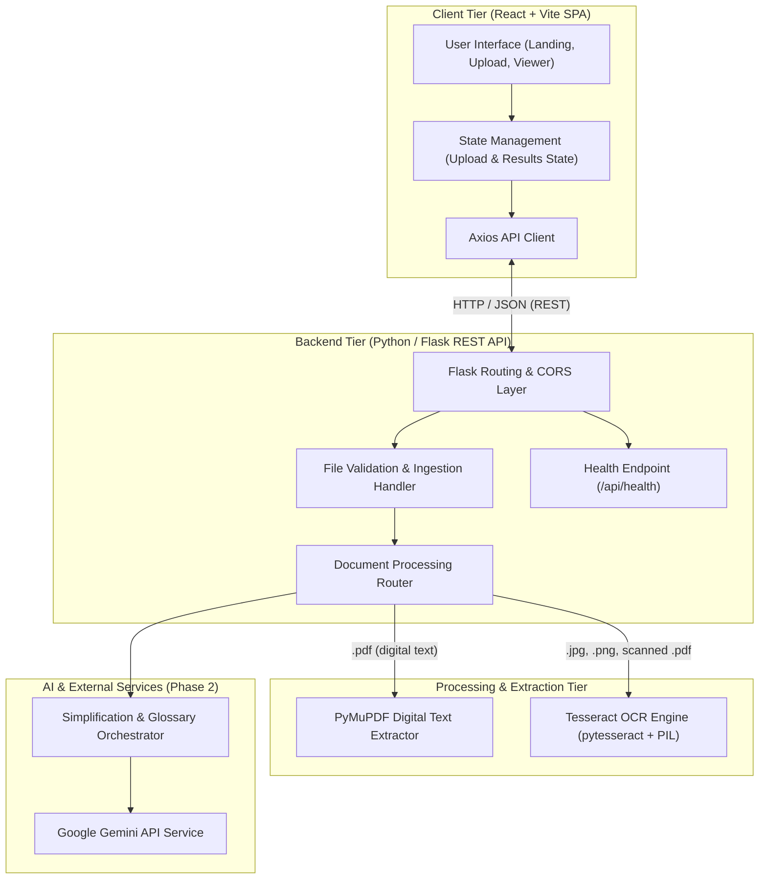
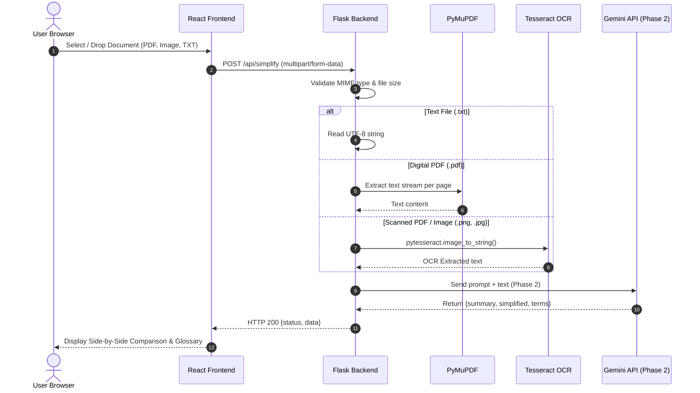

# System Architecture & Technical Specification

## Project: DocuEase – AI-Powered Document Simplification System

---

## 1. System Architecture Overview

DocuEase is designed with a modern, decoupled client-server architecture:
- **Frontend Presentation Layer**: Built with React 19 / Vite, offering a fast, responsive Single Page Application (SPA).
- **Backend API & Processing Layer**: Built with Python 3.13 and Flask, exposing RESTful endpoints.
- **Document Ingestion & OCR Subsystem**: Utilizing PyMuPDF (`fitz`) for digital PDFs, and Tesseract OCR engine (via `pytesseract` and Pillow) for scanned documents and images.
- **AI Intelligence Layer**: Integration with Google Gemini API for natural language simplification, summary extraction, and glossary synthesis.



---

## 2. Component Responsibilities

### 2.1 Frontend Responsibilities
- **User Interface & Branding**: Deliver an accessible, high-contrast, clean web interface presenting DocuEase's mission, guidelines, and document controls.
- **File Ingestion Interface**: Provide drag-and-drop and standard file picker UI with immediate client-side validation (file type: PDF, TXT, PNG, JPG; size: < 10MB).
- **Real-Time Status & Feedback**: Render visual processing states (Idle, Uploading, Processing OCR, Simplifying with AI, Complete, Error).
- **Dual-Pane Document Viewer**: Render synchronized side-by-side panes contrasting original document text with simplified explanations.
- **Interactive Terminology Cards**: Display detected technical terms and definitions in accessible badges and cards.
- **Productivity Utilities**: Provide one-click copy actions for simplified text, summaries, and glossary sections.
- **Backend Health Monitoring**: Check and display backend connection health dynamically.

### 2.2 Backend Responsibilities
- **Request Routing & CORS Management**: Safe cross-origin resource sharing configured via `flask-cors` for frontend communication.
- **Payload Validation & Security**: Validate uploaded files against allowed MIME types and enforce safe filename handling via `werkzeug.utils.secure_filename`.
- **Text Extraction Routing**:
  - Determine whether incoming files require direct reading (TXT), native PDF text stream parsing (PyMuPDF), or OCR processing (Tesseract).
- **OCR Engine Management**: Configure and coordinate Tesseract binary execution paths (`C:\Program Files\Tesseract-OCR\tesseract.exe`), image preprocessing, and text parsing.
- **AI Orchestration (Phase 2)**: Construct structured prompt templates, manage API calls to Google Gemini, parse JSON-structured responses, and handle token/rate limits.
- **Comprehensive Error Handling**: Return normalized HTTP status codes (200, 400, 413, 422, 500) with clear diagnostic JSON envelopes.

---

## 3. Workflows & Pipelines

### 3.1 PDF Extraction Workflow
1. Client uploads `.pdf` file via `POST /api/extract` (or full pipeline endpoint).
2. Backend validates document header and structure using PyMuPDF (`fitz.open`).
3. The engine iterates over pages:
   - Evaluates if selectable text is present on the page.
   - If selectable text is sufficient (> 50 characters/page), text is directly extracted via `page.get_text()`.
   - If selectable text is absent (scanned PDF), the page is rendered to a pixmap image at 300 DPI and routed to the OCR pipeline.
4. Extracted text from all pages is aggregated with consistent line breaks.

### 3.2 OCR Workflow (Tesseract OCR)
1. For image uploads (`.png`, `.jpg`, `.jpeg`) or scanned PDF pages:
2. Pillow (`PIL.Image`) loads the image into memory.
3. Preprocessing is applied if needed (grayscale conversion, contrast enhancement).
4. `pytesseract.image_to_string()` is executed with the verified Windows binary path (`C:\Program Files\Tesseract-OCR\tesseract.exe`).
5. Extracted text is cleaned of invalid control characters and normalized.

### 3.3 AI Processing Workflow (Phase 2 Target)
1. Extracted text is partitioned into logical chunks if length exceeds context boundaries.
2. Structured prompt is assembled:
   - System instruction: Act as a plain-language communicator.
   - Output schema: JSON containing `summary`, `simplified_text`, and `terminology` (list of `{term, definition}`).
3. Request sent to Google Gemini model.
4. Response validated and serialized into the API response envelope.



---

## 4. API Communication & Contracts

### 4.1 Health Check Endpoint
- **URL**: `/api/health`
- **Method**: `GET`
- **Response Format**:
  ```json
  {
    "status": "success",
    "message": "DocuEase backend is running"
  }
  ```

### 4.2 Standard Response Envelope
All future endpoints follow a standardized contract:
- Success: `{ "status": "success", "data": { ... } }`
- Error: `{ "status": "error", "message": "Human-readable description", "code": "ERROR_CODE" }`

---

## 5. Error-Handling Strategy
1. **Client-Side Validation**:
   - Prevent submission of unsupported file extensions (`.exe`, `.zip`, etc.).
   - Reject files exceeding max size threshold (10 MB) prior to network transmission.
2. **Network & Backend Resilience**:
   - Timeouts configured on all external calls (Tesseract: 30s timeout per page; Gemini: 25s timeout).
   - HTTP 400 Bad Request for malformed files or missing payload.
   - HTTP 413 Payload Too Large when exceeding size limits.
   - HTTP 422 Unprocessable Entity for unreadable or encrypted PDFs.
   - HTTP 500 Internal Server Error with sanitized error logs and safe user messaging.
3. **Graceful Fallbacks**:
   - If Gemini API quota is reached or unavailable, backend can return raw extracted text with a descriptive notification rather than a total crash.
